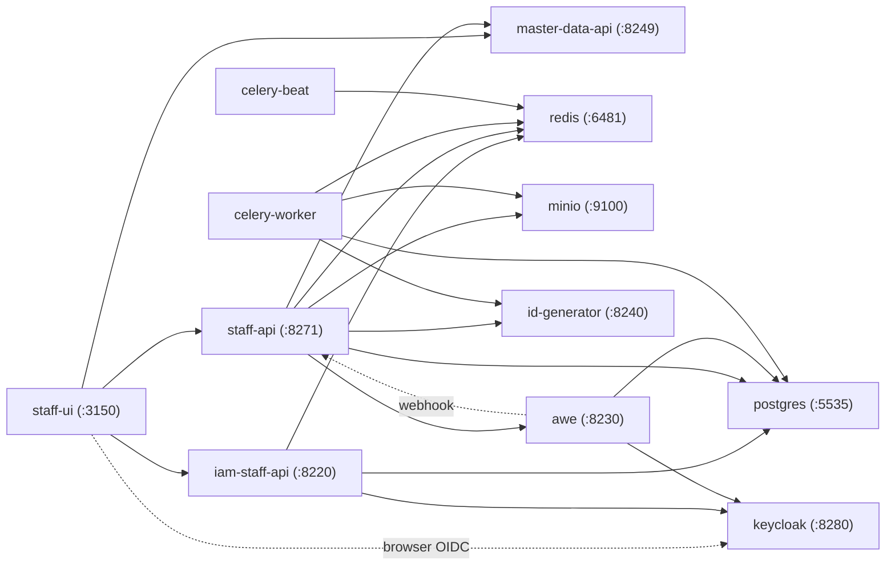

# Standalone Refugee Registry Architecture

## Service Topology

## Bootstrap Sequence (`scripts/up.sh`)

1. Start infrastructure & platform services (`postgres`, `redis`, `minio`, `keycloak`, `iam-staff-api`, `awe`, `id-generator`, `master-data-api`, `staff-api`, `celery-worker`, `celery-beat`, `staff-ui`) waiting on Compose healthchecks.
2. Run `minio-init` to create `default_bucket`, `templates`, and `registrant-photos`.
3. Run `bootstrap-core`:
   - Creates `refugee` Keycloak realm, clients (`iam-staff-portal`, `refugee-registry-staff-portal`, `awe-admin-resolver`), 11 client roles, scope mappings, and demo users (`staff`, `alex.carter`, `nina.patel`).
   - Registers `refugee-registry-staff-portal` (72 permissions, 11 roles) in `iam_staff` and updates `login_providers`.
   - Seeds `callback_secret` in `awe`.
   - Waits for `id-generator` `household` (10-digit) and `refugee` (12-digit) pools to be populated.
4. Run `mds-seed`: loads pinned `openg2p-data` `packs/ETH` geo hierarchy + `./data/codelists/refugee/` into `refugee_master_data_db`.
5. Run `db-seed`: seeds `meta_data/` tabs/forms/registers, `awe_meta_data/` policies, and (when `LOAD_SAMPLE_DATA=true`) 8 Uganda demo households and 25 refugees.
